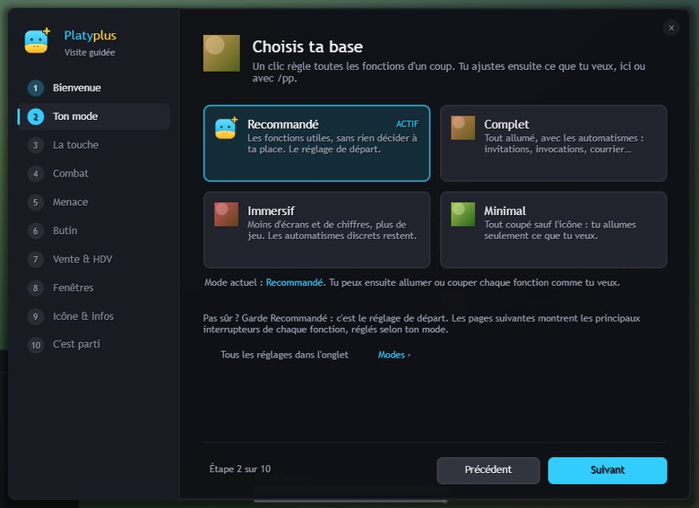
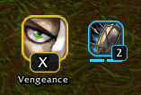
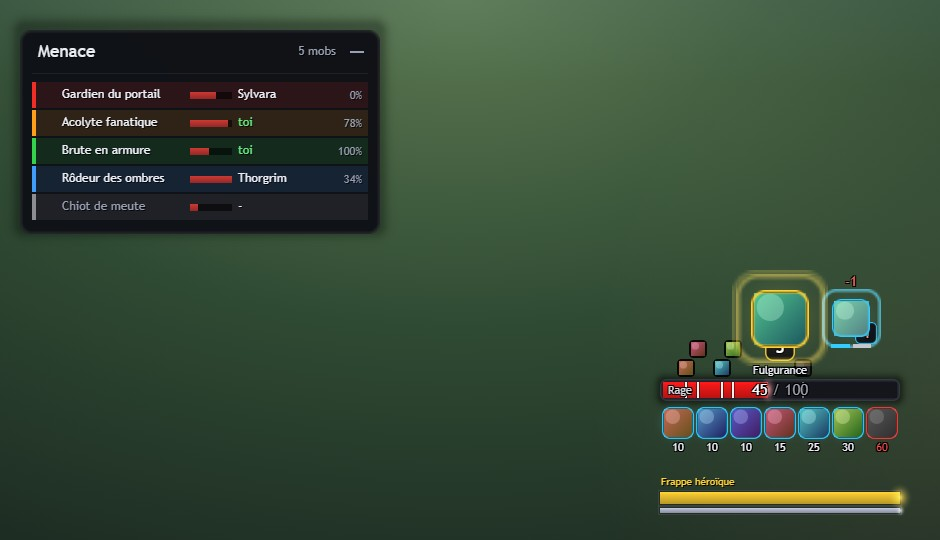
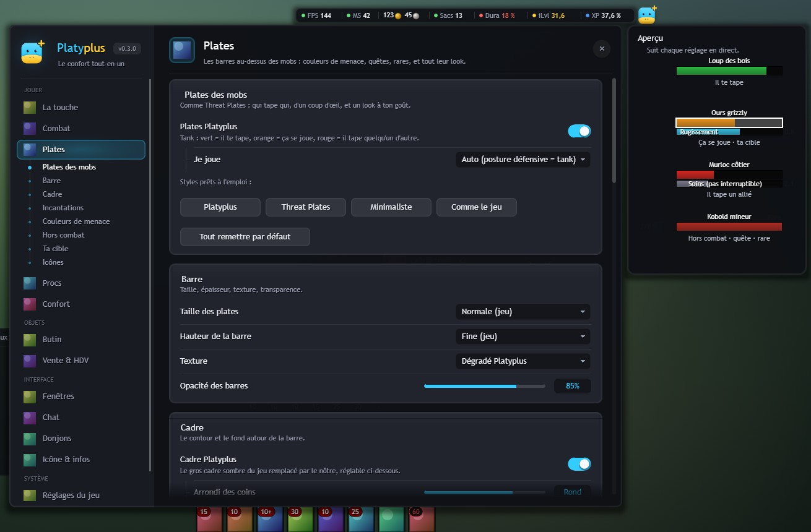
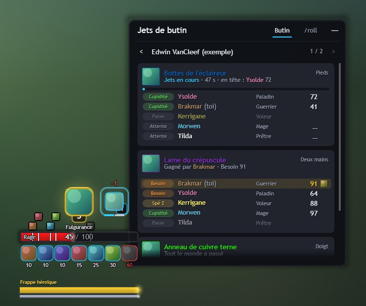
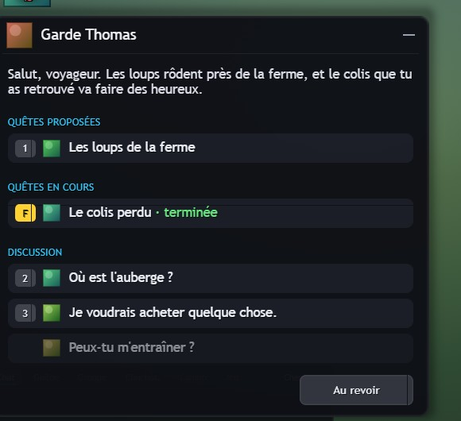
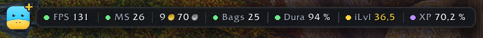

<p align="center">
  
</p>

<h1 align="center">Platyplus</h1>

<p align="center">
  <b>Le confort tout-en-un pour WoW Forever.</b><br>
  Une touche qui fait presque tout, des alertes de combat et une menace lisibles d'un coup d'œil, le butin et la
  vente sans clics, et des fenêtres refaites — dans un seul addon.
</p>

<p align="center">
  <a href="README.md">English</a> ·
  <a href="https://github.com/bloufed/Platyplus/releases/latest">Télécharger</a> ·
  <a href="CHANGELOG.md">Nouveautés</a> ·
  <a href="https://github.com/bloufed/Platyplus/issues">Signaler un bug</a>
</p>

---

Platyplus est né d'un simple raccourci que je voulais en montant mon guerrier sur **WoW Forever**, et il a grandi
tout au long de l'aventure : chaque fois qu'un détail du jeu me paraissait lent, bruyant ou illisible, il est devenu
un nouveau module. Aujourd'hui il remplace une douzaine de petits addons par un seul, avec une seule fenêtre
d'options et un seul style.

Les fonctions utiles sont allumées dès le départ : tu peux jouer tout de suite. Tu préfères une autre base ? Choisis
un mode prêt à l'emploi (**Recommandé**, **Complet**, **Immersif** ou **Minimal**) et toutes les fonctions se règlent
en un clic. Chacune garde son interrupteur dans `/pp`, et une courte visite guidée, à ta première connexion, montre ce
que fait chaque fonction.


> La fenêtre d'options, l'alerte de proc et la barre d'infos sont des captures en jeu. Les autres images sont encore
> rendues par le simulateur hors jeu de l'addon (les icônes d'objets et de sorts sont des pastilles) ; d'autres
> captures arrivent.

## Pourquoi Platyplus

- **Un addon au lieu de douze.** Interaction, butin, vente, alertes de combat, plates, menace, procs, chat, sacs, fiche de
  personnage : une installation, une fenêtre de réglages, un style cohérent.
- **Une touche qui fait tout.** Appuie sur `F` (ou la touche de ton choix) pour parler, ramasser, cueillir,
  dépecer, prendre et rendre les quêtes, et utiliser l'objet de quête au bon endroit.
- **Une menace vraiment lisible.** Des plates colorées selon la menace, et une fenêtre qui liste chaque mob en
  combat et qui le tient.
- **Des fenêtres refaites.** Quêtes, sacs, personnage, chat et jets de butin dans de grandes fenêtres claires,
  dessinées de zéro.
- **Fait pour Forever.** Écrit pour le client Forever (1.60) et ses valeurs secrètes, pas porté d'une autre
  version du jeu.
- **7 langues.** Français, English, Deutsch, Español, Italiano, Português (BR), Русский.

## Premiers pas

1. **Installation.** Télécharge la dernière archive dans [Releases](https://github.com/bloufed/Platyplus/releases/latest)
   (ou sur CurseForge) et décompresse-la pour obtenir
   `World of Warcraft\_forever_\Interface\AddOns\Platyplus\Platyplus.toc`. Relance le jeu.
2. **La visite guidée.** À ta première connexion, une courte visite s'ouvre, en anglais. **Choisis ta langue en haut
   de sa première page** (Français, Deutsch, Español…) : la visite change tout de suite. Ensuite : une page de bienvenue, puis une petite
   page par grande fonction (la touche, le combat, la menace, le butin, la vente, les fenêtres, l'icône), chacune
   avec ses interrupteurs principaux. Passe-la, ou reviens-y quand tu veux avec `/pp bienvenue` (ou `/pp tuto`).
3. **Choisis un mode.** La 2e page de la visite (et l'onglet **Modes** de `/pp`) propose quatre bases. Un clic règle
   toutes les fonctions ; tu changes ensuite ce que tu veux. Survole un mode pour voir exactement ce qu'il change.
   - **Recommandé** (par défaut) : les fonctions utiles allumées, rien qui décide à ta place.
   - **Complet** : tout allumé, automatismes compris : invitations des amis et de la guilde, invocations,
     résurrections, duels refusés, courrier ouvert d'un coup, quêtes prises et rendues sans la touche, mana du healer.
   - **Immersif** : moins d'écrans et de chiffres : ni alertes de combat, ni barre d'infos, ni flux de butin, ni
     fenêtre de menace, ni plates colorées, ni messages d'erreur rouges. Les aides discrètes restent (la touche, le
     loot instantané, la vente, les grandes fenêtres de quête).
   - **Minimal** : tout coupé sauf l'icône ; tu allumes seulement ce que tu veux.

   Un mode ne touche jamais à ta touche, tes listes, les positions, tailles ou couleurs. `/pp mode complet` marche aussi.
4. **Les options.** Tape `/pp`, ou clic gauche sur l'icône Platyplus à l'écran. Les onglets sont à gauche ; survole
   un réglage pour lire ce qu'il fait. Clic droit sur l'icône : un menu rapide pour allumer ou couper les fonctions.
5. **Perdu ?** `/pp help` liste toutes les commandes dans le chat.



## Fonctions

### La touche

- Une touche pour interagir avec ce que tu survoles, ou ce qui est le plus proche : PNJ, coffres, plantes,
  cadavres à dépecer.
- La même touche fait avancer les dialogues, accepte et rend les quêtes, et peut choisir la première option de
  dialogue.
- Elle utilise l'objet de quête au bon endroit (Maj + touche pour interagir quand même).
- Deux autres touches pour **manger** et **boire** : le meilleur de tes sacs hors combat, une potion en combat.

### Combat




- **Alertes de proc** : le sort qui vient de devenir utilisable s'affiche avec son icône et sa touche (Fulgurance,
  Vengeance, Exécution, Riposte, Contre-attaque..., les sorts qui brillent pour les lanceurs de sorts, et ceux que
  tu ajoutes).
- **Barre de coups blancs** : elle se remplit jusqu'à ta prochaine attaque automatique, pour placer Frappe
  héroïque au bon moment.
- **Fenêtre de menace** : une ligne par mob en combat — sa vie, qui il tape, ton pourcentage de menace.
- **Plates de menace** dans l'esprit de Threat Plates : couleurs tank ou dégâts, avancée des quêtes, étiquettes
  rare / élite / boss, barres d'incantation qui te disent quand ton interruption est prête. Préréglages, barres
  arrondies, aperçu en direct.
- **Rappels de buffs** (Cri de guerre et compagnie), les buffs que tu peux offrir aux alliés, et « Demander un
  buff » au clic droit sur un joueur.
- **Barre de mana du healer** du groupe, et **contrôles des mobs dans l'infobulle** : leurs étourdissements,
  immobilisations, ralentissements et peurs, avec leur durée.

| Fenêtre de menace | Plates de menace |
|---|---|
|  |  |

### Butin et or

- **Butin instantané**, étincelles sur ce qui se ramasse (plantes, objets de quête, cadavres avec du butin), et un
  **flux de butin** flottant qui montre aussi ce que tu achètes, fabriques, vends et reçois des quêtes.
- **Suivi des jets de butin** : chaque objet, chaque joueur, qui a fait besoin, cupidité, qui a gagné — et un
  onglet `/roll`.
- **Vente automatique** des objets gris et de l'équipement inutilisable, avec des listes « jamais vendre » /
  « toujours vendre » et un aperçu avant toute vente. Réparation automatique.
- **Aide à l'hôtel des ventes** : scan des sacs, mise en vente en quelques clics, prix retenus par royaume et
  faction, et coût d'une recette face à l'hôtel des ventes.



### Fenêtres

- **Fenêtre de quête et de dialogue** en grand, avec de grandes **cartes de récompense** qui mettent en avant le
  meilleur choix pour toi.
- **Une seule fenêtre de sacs** pour tous tes sacs, avec tri.
- **Fenêtre du personnage** avec les onglets réputation, compétences, JcJ et monnaies, niveau d'objet et
  durabilité.
- **Chat** : une fenêtre de chat plus propre, à onglets, avec filtres anti-spam, un historique qui survit au
  rechargement et des liens copiables.

| Cartes de récompense | Fenêtre de quête |
|---|---|
|  |  |

| Personnage | Chat |
|---|---|
|  |  |

### Confort

- Invitations de groupe, duels et invocations acceptés ou refusés pour toi ; des messages d'erreur plus discrets.
- Une petite **icône** avec sa barre d'infos : FPS, latence, or, place dans les sacs, durabilité, niveau d'objet,
  XP et XP par heure — où tu veux à l'écran.
- Les **réglages du jeu** recommandés, en un clic.



## Commandes

| Commande | Effet |
|---|---|
| `/pp` | Ouvre la fenêtre d'options |
| `/pp help` | Liste toutes les commandes |
| `/pp bienvenue` | Relance la visite guidée (aussi `/pp tuto`) |
| `/pp mode [nom]` | Montre ton mode, ou en change : `recommande`, `complet`, `immersif`, `minimal` |
| `/pp key` | Change la touche |
| `/pp menace` | Fenêtre de menace (`on`, `off`, `test`, `reset`) |
| `/pp plates` | Plates (`on`, `off`, `tank`, `dps`, `auto`) |
| `/pp proc` | Alerte de proc : ce qui est surveillé, aperçu |
| `/pp jets` | Fenêtre des jets de butin |
| `/pp mob` | Contrôles des mobs dans l'infobulle |
| `/pp langue` | Langue (`auto`, `frFR`, `enUS`, `deDE`, `esES`, `itIT`, `ptBR`, `ruRU`) |

## Bon à savoir

- **État.** Platyplus est jeune et en développement actif. Il a été écrit et joué sur un guerrier ; les
  autres classes sont prises en charge mais moins éprouvées. Les retours de bugs sont les bienvenus.
- **Fenêtres remplacées.** Platyplus dessine ses propres fenêtres de quête, de sacs, du personnage et de chat. Si
  tu préfères celles du jeu, coupe-les dans les onglets **Fenêtres** et **Chat** (ou sur la page « Fenêtres » de la
  visite) : les originales reviennent tout de suite.
- **Ta touche.** Platyplus utilise `F` par défaut. Si le jeu avait déjà une action sur cette touche, l'onglet
  **La touche** te le signale ; choisis-en une autre là, ou avec `/pp key`.
- **Journal des donjons.** Platyplus n'embarque pas de journal des donjons. Si tu installes
  [DungeonJournal d'Exehn](https://www.curseforge.com/wow/addons/dungeonjournal), Platyplus l'ouvre depuis son
  menu, son onglet Donjons et `/pp donjons`, et l'habille : le style Platyplus, une colonne « Donjons » à gauche
  et une ligne « À ton niveau » sur l'accueil (chacun avec son interrupteur). Ces ajouts sont ceux de Platyplus,
  pas d'Exehn : éteins-les dans l'onglet Donjons avant de signaler un bug à DungeonJournal.
- **Traducteur.** Le dossier `Traducteur/` de ce dépôt est un programme Windows facultatif (Python + un modèle
  Ollama local) qui traduit le chat en français. Il ne fait pas partie du téléchargement de l'addon.

## Pour les développeurs

La racine du dépôt est le dossier de l'addon. `dev/` contient un simulateur de WoW hors jeu, une cinquantaine de
fichiers de tests et les outils autour ; rien de tout cela n'est dans l'archive publiée.

```
python -I dev/verifier.py          # syntaxe de tous les fichiers + tous les tests hors jeu
python -I dev/apercu.py            # aperçus HTML de chaque fenêtre
```

Les commentaires et les textes source sont en français ; les traductions sont dans `Locales/`.

Une version se publie en poussant un tag (`v1.0.0`) : une action GitHub fabrique l'archive, l'attache à la release
et l'envoie sur CurseForge.

## Crédits et licence

Platyplus est un logiciel libre sous [GNU GPL v3 ou ultérieure](LICENSE).

- Les étincelles de butin sont adaptées de **Forever Loot Sparkles** d'Ashtar Senior (GPL-3.0-or-later).
- Les données de contrôle des mobs sont générées depuis la base **VMaNGOS** (GPL-2.0).
- Les plates de menace s'inspirent de **Threat Plates** ; le journal des donjons facultatif est **DungeonJournal**
  d'Exehn.
- Les notices complètes sont dans [`Licenses/`](Licenses).

World of Warcraft est une marque de Blizzard Entertainment. Platyplus n'est pas affilié à Blizzard.
