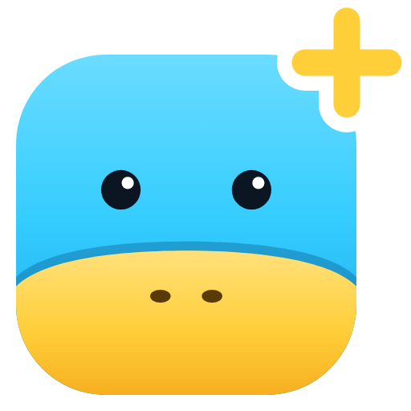
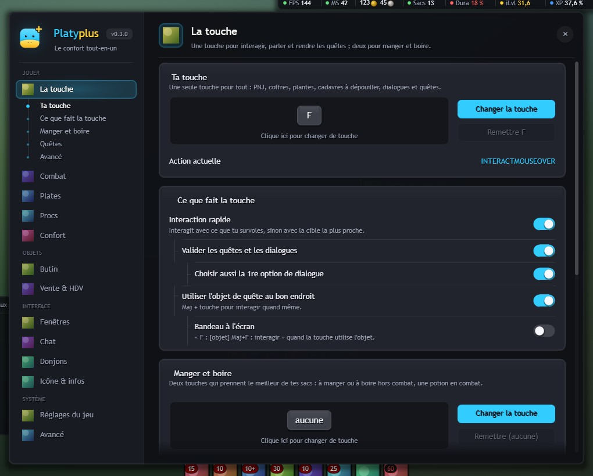

<p align="center">
  
</p>

<h1 align="center">Platyplus</h1>

<p align="center">
  <b>Appuie sur F. C'est à peu près tout l'addon.</b> (Le reste est pas mal non plus.)<br>
  Une douzaine d'addons de confort dans un seul ornithorynque, pour WoW Forever.
</p>

<p align="center">
  <a href="README.md">English</a> ·
  <a href="https://www.curseforge.com/wow/addons/platyplus">CurseForge</a> ·
  <a href="https://github.com/bloufed/Platyplus/releases/latest">Télécharger</a> ·
  <a href="CHANGELOG.md">Nouveautés</a> ·
  <a href="https://github.com/bloufed/Platyplus/issues">Signaler un bug</a>
</p>

---

L'ornithorynque, c'est un canard, un castor et une loutre qui ont accepté de partager le même corps. Platyplus fait
pareil avec ton dossier AddOns : une douzaine de petits addons de confort, une seule installation, une seule fenêtre
de réglages, un seul style.

Il est né sur **WoW Forever**, en montant un guerrier qui en avait assez de cliquer sur tout. Écrit pour le client
Forever (1.60) et ses restrictions, pas porté d'ailleurs.



## Une touche

Vise quelque chose (ou pas : il prend ce qui est le plus proche) et appuie sur `F` :

- parler aux PNJ, ramasser coffres et cadavres, cueillir plantes et minerai, dépecer ;
- faire avancer les dialogues, accepter les quêtes, les rendre (et choisir la première option de dialogue, si tu veux) ;
- utiliser l'objet de quête là où la quête le veut (Maj + touche pour interagir quand même).

Deux autres touches pour **manger** et **boire** le meilleur de tes sacs, ou une potion en combat. Ta souris peut
enfin prendre sa retraite.

## Combat

- **Alertes de proc** : le sort qui vient de s'allumer (Fulgurance, Vengeance, Ivresse de la victoire...) s'affiche
  avec son icône et la touche à presser. Toutes les classes (les sorts qui brillent pour les lanceurs de sorts, et
  ceux que tu ajoutes) ; tu choisis combien, avec ou sans son.
- **Fenêtre de menace** : une ligne par mob que tu combats, avec sa vie, qui il tape et ta menace. Survole une ligne
  pour repérer sa plate. Tu sais qui a pull avant que le healer te le dise.
- **Plates de menace**, dans l'esprit de Threat Plates : couleurs tank ou dégâts, avancée des quêtes sur la plate
  (3/8 sangliers), étiquettes rare / élite / boss, et barres d'incantation qui te disent quand ton interruption est
  prête. Préréglages, aperçu en direct, et toutes les couleurs sont à toi.
- **Barre de coups blancs** : elle se remplit jusqu'à ta prochaine attaque automatique, pour placer Frappe héroïque
  au bon moment.
- **Contrôles des mobs dans l'infobulle** : survole un mob pour savoir s'il étourdit, immobilise, ralentit ou fait
  peur, et combien de temps. Repère celui qui va te faire fuir dans le pack d'à côté *avant* de le pull.
- **Rappels de buffs** (Cri de guerre et compagnie), les buffs que tu peux offrir au groupe, et « Demander un buff »
  au clic droit, qui chuchote poliment à ta place.
- **Barre de mana du healer** : la mana de ton healer, toujours sous les yeux.

## Butin et or

- **Butin instantané**, et **étincelles** sur les plantes, le minerai, les cadavres et les objets de quête à ramasser.
- **Flux de butin** flottant : ce que tu viens d'obtenir, là où tu le vois, y compris ce que tu achètes, fabriques,
  vends et reçois des quêtes.
- **Suivi des jets de butin** : chaque objet, chaque jet, qui a gagné, et un onglet `/roll`. Fini les « attends,
  qui a gagné ça ? ».
- **Vente automatique** des gris et de l'équipement inutilisable, avec des listes « jamais vendre » / « toujours
  vendre » et un aperçu avant toute vente. **Réparation automatique** aussi.
- **Aide à l'hôtel des ventes** : scan des sacs, mise en vente en quelques clics, prix retenus par royaume et
  faction, et ce que coûtent tes recettes.

## Fenêtres

- **Fenêtre de quête et de dialogue** en grand, avec des **cartes de récompense** qui mettent en avant le meilleur
  choix pour toi.
- **Une seule fenêtre de sacs** pour tous tes sacs, avec tri.
- **Fenêtre du personnage** avec réputation, compétences, JcJ et monnaies, niveau d'objet et durabilité.
- **Chat** à onglets, avec filtres anti-spam, liens copiables, et un historique qui survit à un `/reload`.

## Confort

- Invitations de groupe, duels et invocations acceptés ou refusés pour toi (c'est toi qui choisis) ; des messages
  d'erreur plus discrets.
- Les **réglages du jeu** recommandés, en un clic.
- Une petite icône ornithorynque avec sa barre d'infos : FPS, latence, or, sacs, durabilité, niveau d'objet et XP.
  Clic sur l'XP pour passer du % à l'XP par heure, au temps avant le niveau et aux mobs avant le niveau.


Chaque fonction a son interrupteur. Tu n'aimes pas notre fenêtre de quête ? Coupe-la. L'ornithorynque n'est pas
rancunier.

## Premiers pas

1. **Installation.** Sur [CurseForge](https://www.curseforge.com/wow/addons/platyplus), ou télécharge la dernière
   archive dans [Releases](https://github.com/bloufed/Platyplus/releases/latest) et décompresse-la pour obtenir
   `World of Warcraft\_forever_\Interface\AddOns\Platyplus\Platyplus.toc`. Relance le jeu.
2. **La visite guidée.** À ta première connexion, une courte visite s'ouvre, en anglais. **Choisis ta langue en haut
   de sa première page** (Français, Deutsch, Español…) : la visite change tout de suite. Ensuite, une petite page par
   grande fonction, avec ses interrupteurs principaux. Reviens-y quand tu veux avec `/pp bienvenue` (ou `/pp tuto`).
3. **Choisis un mode.** La 2e page de la visite (et l'onglet **Modes** de `/pp`) propose quatre bases. Un clic règle
   toutes les fonctions ; tu changes ensuite ce que tu veux. Survole un mode pour voir exactement ce qu'il change.
   - **Recommandé** (par défaut) : les fonctions utiles allumées, rien qui décide à ta place.
   - **Complet** : tout allumé, automatismes compris : invitations des amis et de la guilde, invocations,
     résurrections, duels refusés, courrier ouvert d'un coup, quêtes prises et rendues sans la touche, mana du healer.
   - **Immersif** : moins d'écrans et de chiffres : ni alertes de combat, ni barre d'infos, ni flux de butin, ni
     fenêtre de menace, ni plates colorées, ni messages d'erreur rouges. Les aides discrètes restent (la touche, le
     loot instantané, la vente, les grandes fenêtres de quête).
   - **Minimal** : tout coupé sauf l'icône ; tu allumes seulement ce que tu veux.

   Un mode ne touche jamais à ta touche, tes listes, les positions, tailles ou couleurs. `/pp mode complet` marche aussi.
4. **Les options.** Tape `/pp`, ou clic gauche sur l'icône Platyplus. Les onglets sont à gauche ; survole un réglage
   pour lire ce qu'il fait. Clic droit sur l'icône : un menu rapide pour allumer ou couper les fonctions.
5. **Perdu ?** `/pp help` liste toutes les commandes dans le chat.

## Commandes

| Commande | Effet |
|---|---|
| `/pp` | Ouvre la fenêtre d'options |
| `/pp help` | Liste toutes les commandes |
| `/pp bienvenue` | Relance la visite guidée (aussi `/pp tuto`) |
| `/pp mode [nom]` | Montre ton mode, ou en change : `recommande`, `complet`, `immersif`, `minimal` |
| `/pp key` | Change la touche |
| `/pp menace` | Fenêtre de menace (`on`, `off`, `test`, `reset`) |
| `/pp plates` | Plates (`on`, `off`, `tank`, `dps`, `auto`) |
| `/pp proc` | Alerte de proc : ce qui est surveillé, aperçu |
| `/pp jets` | Fenêtre des jets de butin |
| `/pp mob` | Contrôles des mobs dans l'infobulle |
| `/pp langue` | Langue (`auto`, `frFR`, `enUS`, `deDE`, `esES`, `itIT`, `ptBR`, `ruRU`) |

## Bon à savoir

- **État.** Platyplus est jeune et en développement actif. Il a été écrit et joué sur un guerrier ; les
  autres classes sont prises en charge mais moins éprouvées. Les retours de bugs sont les bienvenus.
- **Fenêtres remplacées.** Platyplus dessine ses propres fenêtres de quête, de sacs, du personnage et de chat. Si
  tu préfères celles du jeu, coupe-les dans les onglets **Fenêtres** et **Chat** (ou sur la page « Fenêtres » de la
  visite) : les originales reviennent tout de suite.
- **Ta touche.** Platyplus utilise `F` par défaut. Si le jeu avait déjà une action sur cette touche, l'onglet
  **La touche** te le signale ; choisis-en une autre là, ou avec `/pp key`.
- **Journal des donjons.** Platyplus n'embarque pas de journal des donjons. Si tu installes
  [DungeonJournal d'Exehn](https://www.curseforge.com/wow/addons/dungeonjournal), Platyplus l'ouvre depuis son
  menu, son onglet Donjons et `/pp donjons`, et l'habille : le style Platyplus, une colonne « Donjons » à gauche
  et une ligne « À ton niveau » sur l'accueil (chacun avec son interrupteur). Ces ajouts sont ceux de Platyplus,
  pas d'Exehn : éteins-les dans l'onglet Donjons avant de signaler un bug à DungeonJournal.
- **Traducteur.** Le dossier `Traducteur/` de ce dépôt est un programme Windows facultatif (Python + un modèle
  Ollama local) qui traduit le chat en français. Il ne fait pas partie du téléchargement de l'addon.

## Pour les développeurs

La racine du dépôt est le dossier de l'addon. `dev/` contient un simulateur de WoW hors jeu, une cinquantaine de
fichiers de tests et les outils autour ; rien de tout cela n'est dans l'archive publiée.

```
python -I dev/verifier.py          # syntaxe de tous les fichiers + tous les tests hors jeu
python -I dev/apercu.py            # aperçus HTML de chaque fenêtre
```

Les commentaires et les textes source sont en français ; les traductions sont dans `Locales/`.

Une version se publie en poussant un tag (`v1.0.1`) : une action GitHub fabrique l'archive, l'attache à la release
et l'envoie sur CurseForge.

## Crédits et licence

Platyplus est un logiciel libre sous [GNU GPL v3 ou ultérieure](LICENSE).

- Les étincelles de butin sont adaptées de **Forever Loot Sparkles** d'Ashtar Senior (GPL-3.0-or-later).
- Les données de contrôle des mobs sont générées depuis la base **VMaNGOS** (GPL-2.0).
- Les plates de menace s'inspirent de **Threat Plates** ; le journal des donjons facultatif est **DungeonJournal**
  d'Exehn.
- Les notices complètes sont dans [`Licenses/`](Licenses).

World of Warcraft est une marque de Blizzard Entertainment. Platyplus n'est pas affilié à Blizzard.
