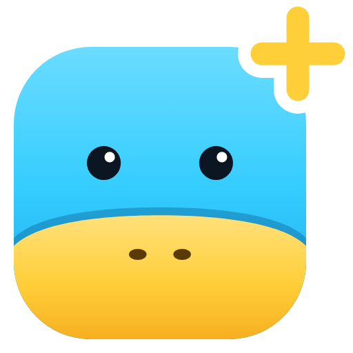
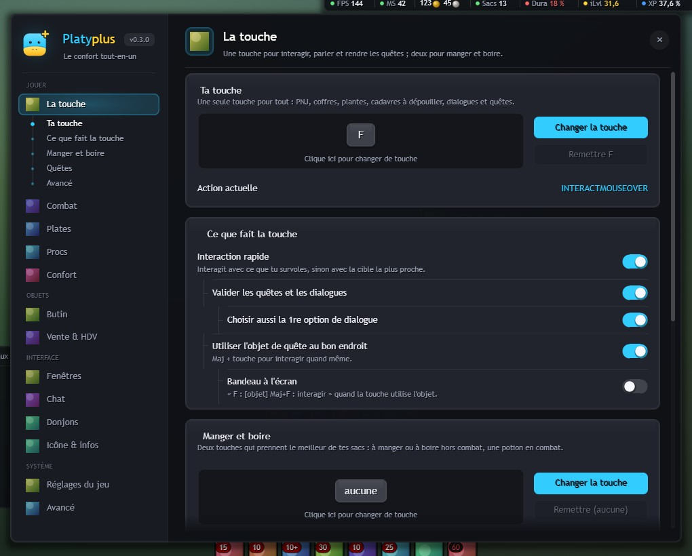
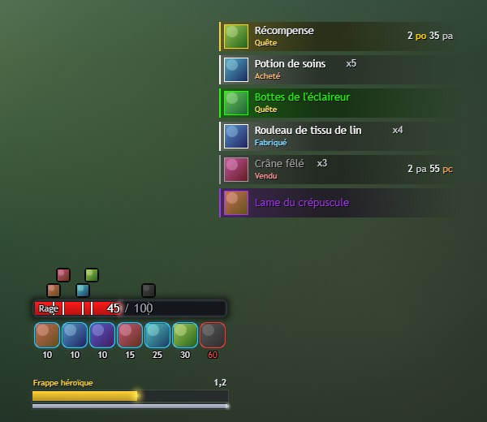
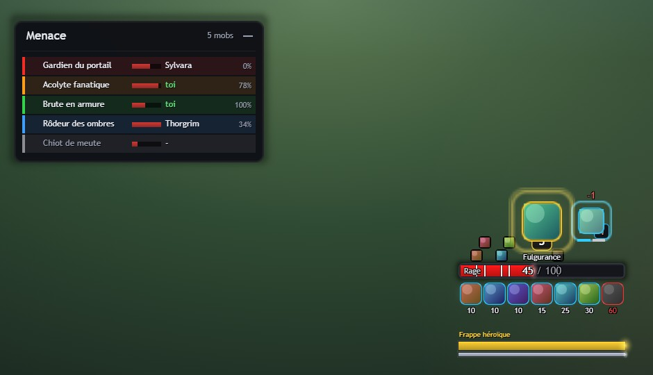
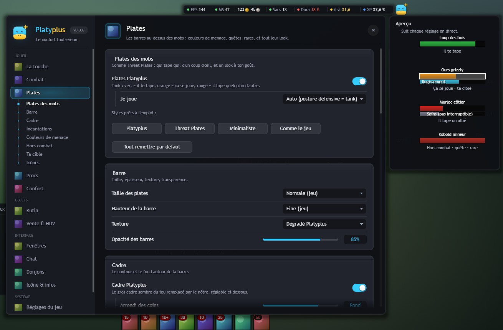
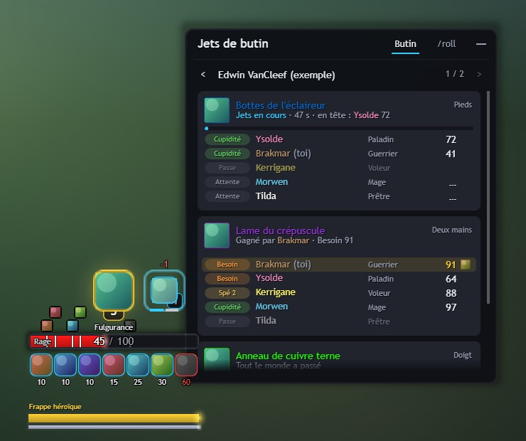
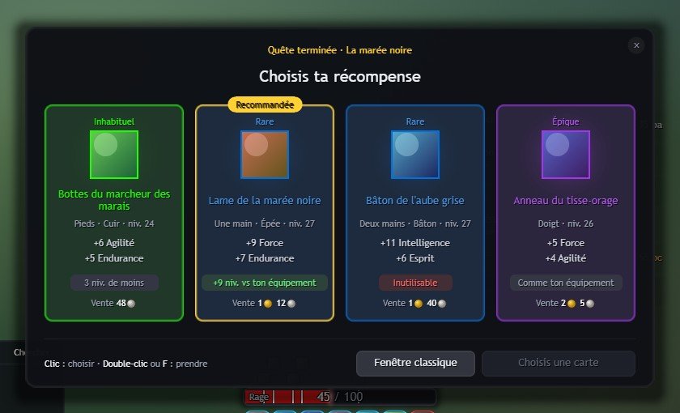
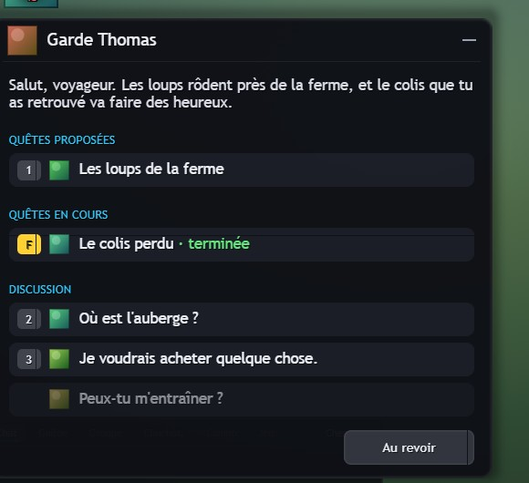
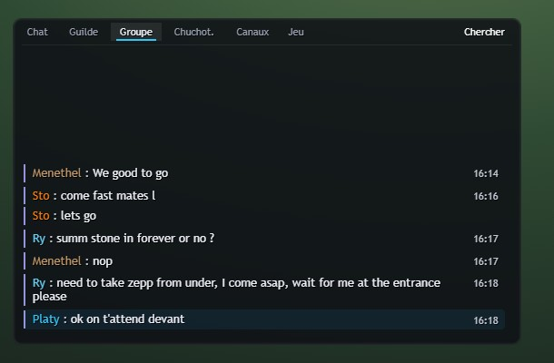

<p align="center">
  
</p>

<h1 align="center">Platyplus</h1>

<p align="center">
  <b>All-in-one quality of life for WoW Forever.</b><br>
  One key that does everything, threat you can read at a glance, and cleaner windows — in a single addon.
</p>

<p align="center">
  <a href="README.fr.md">Français</a> ·
  <a href="https://github.com/bloufed/Platyplus/releases/latest">Download</a> ·
  <a href="CHANGELOG.md">Changelog</a> ·
  <a href="https://github.com/bloufed/Platyplus/issues">Report a bug</a>
</p>

---

Platyplus started as a single shortcut I wanted while leveling my warrior on **WoW Forever**, and it kept growing
through the whole adventure: every time something in the game felt slow, noisy or hard to read, it became a new
module. Today it replaces a dozen small addons with one, with a single options window and one look.

Everything is optional. Each feature has its own switch in `/pp`, and nothing changes your game until you turn it on.



> The images on this page are rendered by the addon's offline simulator (item and spell icons are placeholders).
> In-game screenshots are coming.

## Why Platyplus

- **One addon instead of twelve.** Interaction, loot, selling, combat HUD, nameplates, threat, procs, chat, bags,
  character sheet: one install, one settings window, one consistent style.
- **One key that does everything.** Press `F` (or any key you choose) to talk, loot, gather, skin, accept and turn
  in quests, and use the quest item where it belongs.
- **Threat you can actually read.** Nameplates colored by threat, plus a threat window listing every mob you are
  fighting and who holds it.
- **Windows redone.** Quests, bags, character, chat and loot rolls in large, clean windows drawn from scratch.
- **Built for Forever.** Written against the Forever client (1.60) and its secret-value restrictions, not ported
  from another game version.
- **7 languages.** Français, English, Deutsch, Español, Italiano, Português (BR), Русский.

## Features

### The key

- One key to interact with what you point at, or the nearest thing: NPCs, chests, herbs, corpses to skin.
- The same key advances dialogs, accepts quests and turns them in, and can pick the first dialog option.
- Uses the quest item at the right place (hold Shift to interact normally instead).
- Two more keys to **eat** and **drink**: the best food or drink in your bags out of combat, a potion in combat.

### Combat



- A clear **resource bar** in the middle of the screen, with the cost of your spells marked on it, and a
  **swing timer**.
- **Proc alerts**: the ability that just became usable pops up with its icon and its keybind (Overpower, Revenge,
  Execute, Riposte, Counterattack and the like, glowing spells for casters, plus any spell you add).
- **Threat window**: one line per mob in combat — health, who it is attacking, your threat percentage.
- **Threat nameplates** in the spirit of Threat Plates: tank or damage colors, quest progress, rare / elite / boss
  tags, cast bars that tell you when your interrupt is ready. Presets, rounded bars, live preview.
- **Buff reminders** (Battle Shout and friends), the buffs you can give to allies, and "ask for a buff" in the
  right-click menu of a player.
- **Healer mana bar** for your group, and **mob control tooltips**: which stuns, roots, slows and fears a mob has,
  and how long they last.

| Threat window | Threat nameplates |
|---|---|
|  |  |

### Loot and gold

- **Instant loot**, sparkles on what you can pick up (herbs, quest objects, corpses with loot), and a floating
  **loot feed** that also shows what you bought, crafted, sold and received from quests.
- **Loot roll tracker**: every item, every player, who needs, who greeds, who won — plus a `/roll` tab.
- **Auto-sell** grey items and unusable gear, with "never sell" / "always sell" lists and a preview before anything
  is sold. Auto-repair.
- **Auction house helper**: scan your bags, post in a few clicks, remember prices per realm and faction, and see
  what a recipe costs against the auction house.



### Windows

- **Quest and dialog window** in large type, with big **reward cards** that highlight the best choice for you.
- **One bag window** for all your bags, with sorting.
- **Character window** with reputation, skills, PvP and currency tabs, item level and durability.
- **Chat**: a cleaner chat window with tabs, spam filters, history that survives a reload, and copyable links.

| Reward cards | Quest window |
|---|---|
|  |  |

| Character | Chat |
|---|---|
|  |  |

### Comfort

- Accept or decline group invites, duels and summons for you; quieter error messages.
- A small **launcher icon** with an info bar: FPS, latency, gold, bag space, durability, item level, XP and XP per
  hour — placed wherever you like.
- Recommended **game settings** in one click.

## Install

1. Download the latest zip from [Releases](https://github.com/bloufed/Platyplus/releases/latest)
   (or from CurseForge).
2. Extract it so that you get `World of Warcraft\_forever_\Interface\AddOns\Platyplus\Platyplus.toc`.
3. Restart the game, then type `/pp`.

## Commands

| Command | What it does |
|---|---|
| `/pp` | Open the options window |
| `/pp help` | List every command |
| `/pp key` | Change the key |
| `/pp menace` | Threat window (`on`, `off`, `test`, `reset`) |
| `/pp plates` | Nameplates (`on`, `off`, `tank`, `dps`, `auto`) |
| `/pp proc` | Proc alert: what is watched, preview |
| `/pp jets` | Loot roll window |
| `/pp mob` | Mob control tooltips |
| `/pp langue` | Language (`auto`, `frFR`, `enUS`, `deDE`, `esES`, `itIT`, `ptBR`, `ruRU`) |

## Good to know

- **Status.** Platyplus is young (0.x) and under active development. It was built and played on a warrior; other
  classes are supported but less battle-tested. Bug reports are very welcome.
- **Dungeon journal.** Platyplus does not include a dungeon journal. If you install
  [DungeonJournal by Exehn](https://www.curseforge.com/wow/addons/dungeonjournal), Platyplus opens it from its
  menu, its Dungeons tab and `/pp donjons`.
- **Translator companion.** The `Traducteur/` folder of this repository is an optional Windows program (Python +
  a local Ollama model) that translates chat into French. It is not part of the addon download.

## For developers

The repository root is the addon folder. `dev/` holds an offline WoW simulator, about fifty test files and the
tools around them; none of it ships in the release zip.

```
python -I dev/verifier.py          # syntax of every file + all offline tests
python -I dev/apercu.py            # render the HTML previews of every window
```

Comments and source strings are in French; translations live in `Locales/`.

Releases are cut by pushing a tag (`v0.3.0`): a GitHub Action builds the zip, attaches it to the release and
uploads it to CurseForge.

## Credits and license

Platyplus is free software under the [GNU GPL v3 or later](LICENSE).

- Loot sparkles are adapted from **Forever Loot Sparkles** by Ashtar Senior (GPL-3.0-or-later).
- Mob control data is generated from the **VMaNGOS** database (GPL-2.0).
- Threat nameplates are inspired by **Threat Plates**; the optional dungeon journal is **DungeonJournal** by Exehn.
- See [`Licenses/`](Licenses) for the full notices.

World of Warcraft is a trademark of Blizzard Entertainment. Platyplus is not affiliated with Blizzard.
