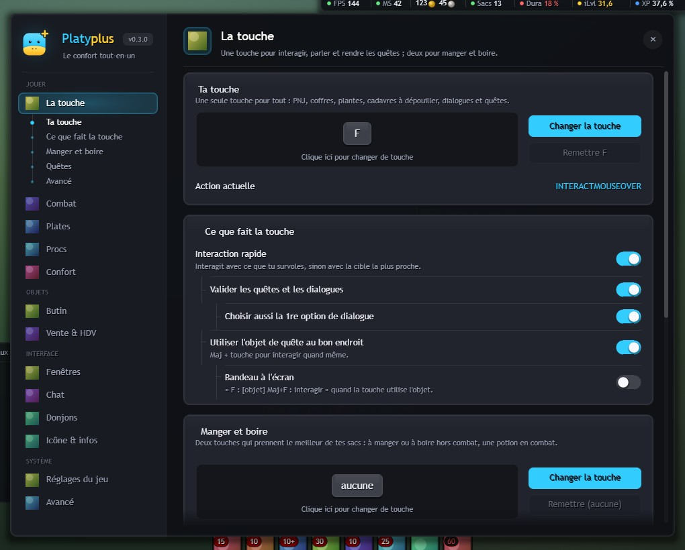
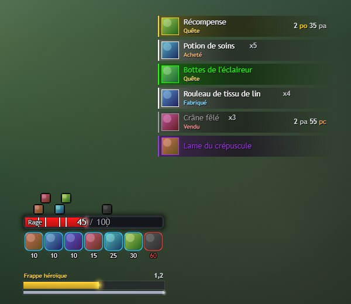
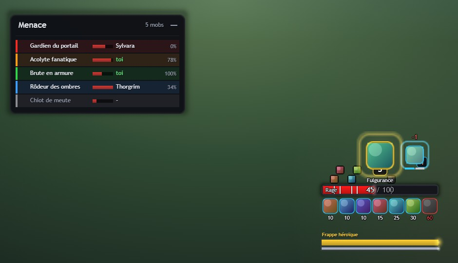
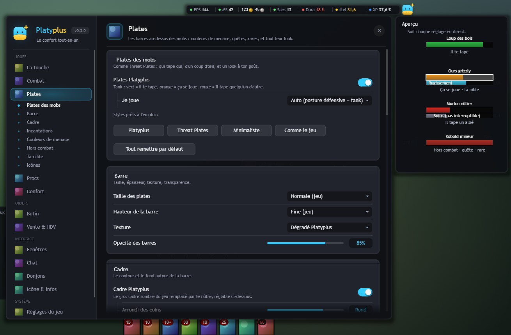
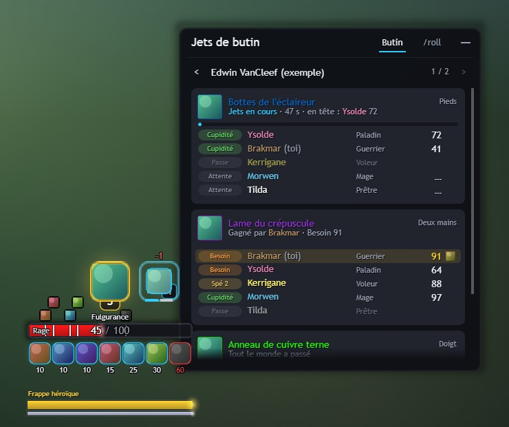
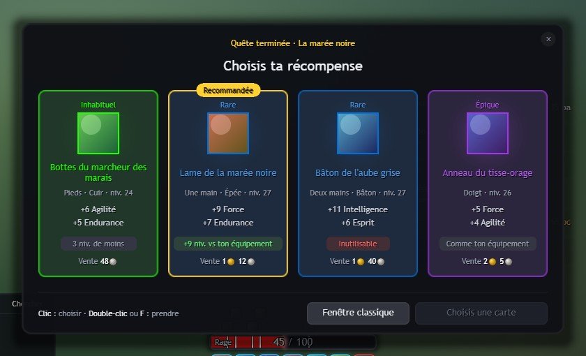
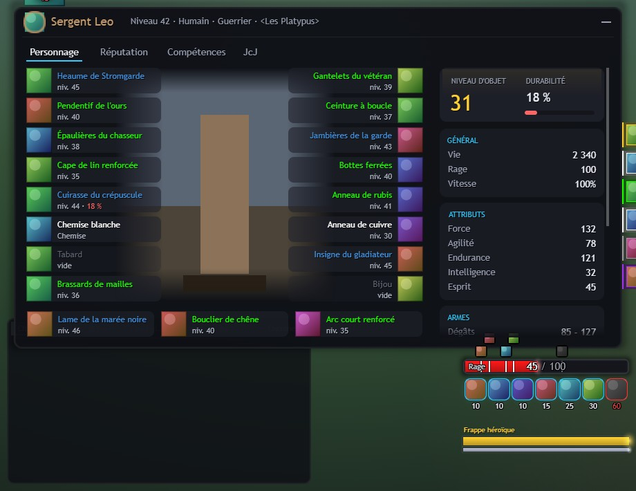

<!--
  Description du projet CurseForge (à coller dans l'éditeur en mode Markdown).
  Résumé (champ « Summary », 1 ligne) :
  All-in-one quality of life for WoW Forever: one key that does everything, readable threat, cleaner windows.
-->

# Platyplus — all-in-one quality of life for WoW Forever

**One key that does everything, threat you can read at a glance, and cleaner windows — in a single addon.**

Platyplus started as a single shortcut I wanted while leveling my warrior on WoW Forever, and it kept growing through the whole adventure: every time something in the game felt slow, noisy or hard to read, it became a new module. Today it replaces a dozen small addons with one, with a single options window and one look.

Everything is optional: each feature has its own switch in **/pp**.

## Why you want it

* **One addon instead of twelve** — interaction, loot, selling, combat HUD, nameplates, threat, procs, chat, bags, character sheet. One install, one settings window.
* **One key that does everything** — press F (or your key) to talk, loot, gather, skin, accept and turn in quests, and use the quest item where it belongs.
* **Threat you can actually read** — nameplates colored by threat, and a threat window listing every mob you are fighting and who holds it.
* **Windows redone** — quests, bags, character, chat and loot rolls in large, clean windows.
* **Built for Forever** — written for the Forever client and its restrictions, not ported from another version.
* **7 languages** — Français, English, Deutsch, Español, Italiano, Português (BR), Русский.

## The key

* One key to interact with what you point at, or the nearest thing: NPCs, chests, herbs, corpses to skin.
* The same key advances dialogs, accepts quests and turns them in.
* Uses the quest item at the right place.
* Two more keys to eat and drink: the best of your bags out of combat, a potion in combat.

## Combat

* Clear **resource bar** with the cost of your spells marked on it, and a **swing timer**.
* **Proc alerts**: the ability that just became usable pops up with its icon and keybind.
* **Threat window**: one line per mob in combat — health, who it attacks, your threat.
* **Threat nameplates**: tank or damage colors, quest progress, rare / elite / boss tags, cast bars that tell you when your interrupt is ready. Presets and live preview.
* **Buff reminders**, buffs you can give to allies, and "ask for a buff" on right-click.
* **Healer mana bar**, and **mob control tooltips** (stuns, roots, slows, fears and their duration).

## Loot and gold

* **Instant loot**, sparkles on what you can pick up, and a floating **loot feed**.
* **Loot roll tracker**: every item, every player, who won — plus a /roll tab.
* **Auto-sell** greys and unusable gear, with never-sell / always-sell lists and a preview. Auto-repair.
* **Auction house helper**: scan your bags, post in a few clicks, price memory per realm, recipe cost.

## Windows

* **Quest and dialog window** in large type, with **reward cards** that highlight the best choice.
* **One bag window** for all your bags.
* **Character window** with reputation, skills, PvP and currencies, item level and durability.
* **Chat** with tabs, spam filters and history that survives a reload.

## Comfort

* Accept or decline group invites, duels and summons for you.
* A launcher icon with an info bar: FPS, latency, gold, bags, durability, item level, XP per hour.
* Recommended game settings in one click.

## Getting started

Install, log in, type **/pp**. A welcome page shows what is on, and the options window opens on the tab where you choose your key. **/pp help** lists every command.

## Good to know

* Platyplus is young and under active development. It was built and played on a warrior; other classes are supported but less battle-tested. Please report bugs on [GitHub](https://github.com/bloufed/Platyplus/issues).
* Platyplus does not bundle a dungeon journal. Install [DungeonJournal](https://www.curseforge.com/wow/addons/dungeonjournal) by Exehn and Platyplus opens it from its menu.
* Images on this page come from the addon's offline simulator; spell and item icons are placeholders.

## Credits

Free software, GPL v3 or later — source on [GitHub](https://github.com/bloufed/Platyplus). Loot sparkles adapted from Forever Loot Sparkles by Ashtar Senior. Mob control data generated from the VMaNGOS database. Nameplates inspired by Threat Plates.

---

## En français

**Le confort tout-en-un pour WoW Forever : une touche qui fait tout, une menace lisible d'un coup d'œil et des fenêtres refaites, dans un seul addon.**

Platyplus est né d'un simple raccourci que je voulais en montant mon guerrier, et il a grandi tout au long de mon aventure Forever. Il remplace une douzaine de petits addons : interaction, butin instantané, vente automatique, barre de ressource, alertes de proc, plates et fenêtre de menace, fenêtres de quête, de sacs, de personnage, de chat et de jets de butin, icône avec barre d'infos. Tout se règle dans **/pp**, chaque fonction a son interrupteur, et l'addon est entièrement en français.
